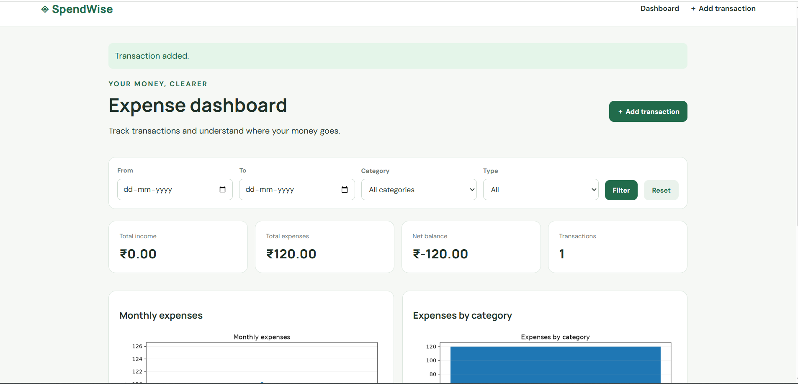

# SpendWise — Personal Expense Tracker & Analytics

SpendWise is a Python-based web application that helps users record, organize, and analyze their personal income and expenses through a simple dashboard.

## Features

- **Dashboard:** View income, expenses, net balance, and transaction count.
- **Transaction management:** Add and delete income or expense records.
- **Category filtering:** Filter transactions by category.
- **Data visualization:** View expense analytics through charts.
- **CSV export:** Export transaction data for further analysis.
- **Database storage:** Store transactions using SQLite by default.

## Technology Stack

- **Language:** Python
- **Web framework:** Flask
- **Database:** SQLite
- **Data analysis:** Pandas
- **Charts:** Matplotlib
- **Frontend:** HTML and CSS
- **ORM:** Flask-SQLAlchemy

## Project Structure

```text
personal-expense-tracker/
├── app.py
├── requirements.txt
├── schema.sql
├── README.md
├── .env.example
├── .gitignore
├── sample_data/
│   └── sample_transactions.csv
├── static/
│   └── style.css
└── templates/
    ├── base.html
    ├── dashboard.html
    └── add.html
```

## Getting Started

### 1. Clone the repository

```bash
git clone https://github.com/geetaharinic/personal-expense-tracker.git
cd personal-expense-tracker
```

### 2. Create a virtual environment

**Windows:**

```powershell
python -m venv .venv
.\.venv\Scripts\Activate.ps1
```

### 3. Install dependencies

```bash
pip install -r requirements.txt
```

### 4. Configure environment variables

Copy the example environment file:

```powershell
Copy-Item .env.example .env
```

### 5. Run the application

```bash
python app.py
```

Open `http://127.0.0.1:5000` in your browser.

## Dashboard Preview



*SpendWise dashboard showing personal expense analytics and transaction summaries.*

## Learning Outcomes

This project demonstrates practical use of Python, Flask routing, database operations, data analysis, chart generation, CSV export, and Git-based version control.

## Future Improvements

- Add user authentication and individual accounts.
- Add monthly budgets and spending limits.
- Add date-range analytics and reports.
- Improve mobile responsiveness.
- Deploy the application to a public hosting platform.

## Author

**Geeta Harini**

- GitHub: [@geetaharinic](https://github.com/geetaharinic)

---

*Built as a learning project to practice Python web development and data analytics.*